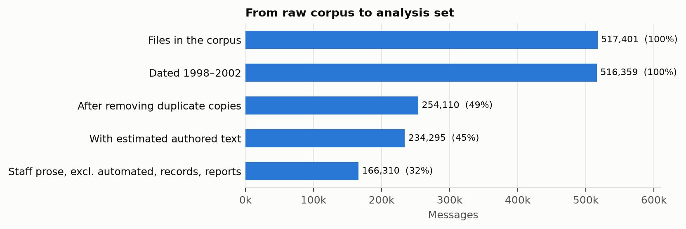
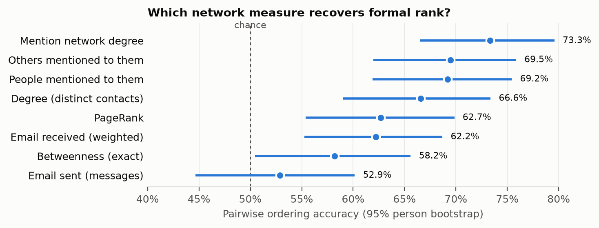

# Hidden Functional Importance in Workplace Email (Enron)

*Can language and communication patterns in email measure how much an
organization depends on a person, and where that differs from their formal rank?*

**Status: rebuild in progress (September 2026).** The first version of this
project (March–May 2026) is preserved in [`legacy/`](legacy/) with a note on why
it is being replaced. Every number and figure below is regenerated by
`make all` from the public corpus, except the gold-standard evaluation, which
needs a release the authors share on request. The data layer and both
evaluations were audited independently six times on 2026-09-25 and 26:
[data audit](audits/data_audit_codex_2026-09-25.md),
[re-audit](audits/reaudit_codex_2026-09-25.md),
[gold-standard audit](audits/gold_audit_codex_2026-09-25.md),
[audit 3](audits/audit3_codex_2026-09-25.md),
[audit 4](audits/audit4_codex_2026-09-26.md) and
[audit 5](audits/audit5_codex_2026-09-26.md). The responses
([1](audits/response_2026-09-25.md), [2](audits/response_reaudit_2026-09-25.md),
[3](audits/response_gold_audit_2026-09-25.md), [4](audits/response_audit3_2026-09-26.md),
[5](audits/response_audit4_2026-09-26.md), [6](audits/response_audit5_2026-09-26.md))
list how each finding was addressed and what remains open. After audit 5 the
pipeline is frozen: the remaining questions (whether a name denotes the
right person, whether text is authored or a signature, whether a link is
the immediate reply) need blinded human labels, which are the first Phase 3
task. One change has been made since the freeze, after a labelled check:
time-shifted copies are now flagged up to 17 hours apart instead of 8
([details](#phase-3-time-shifted-copies-a-correction-after-the-freeze)).

## Research question

Prior NLP work predicts **formal hierarchy** from email (who outranks whom).
This project aims to treat formal rank and **functional importance** (how much
others depend on a person) as separate quantities, measure both from the
Enron corpus, and study where they diverge. Validating functional importance
(for example against what happened to a person's contacts after they left) is
a planned later phase; nothing in the current code measures it yet.

## Pipeline

| Stage | Module | Output |
|---|---|---|
| Download and verify corpus (SHA-256, every run) | `download.py` | `data/raw/enron_mail_20150507.tar.gz` |
| Parse every message from the archive | `ingest.py` | `data/interim/messages_raw.parquet` |
| Analysis window, deduplication, copy provenance | `dedupe.py` | `copies.parquet`, `probable_copy` flag |
| Estimated authored text (quotes, forwards, disclaimers removed) | `clean.py` | `authored` column |
| Automated, structured, signature-only and routine message flags | `senders.py` | message flags |
| Per-message sender attribution, address table, person-text flag | `identity.py` | `sender_people.parquet`, `identities.parquet` |
| Inferred reply and forward links between people, threads | `threads.py` | `links.parquet` |
| Formal-rank labels from the 2004 title list | `formal_rank.py` | `formal_rank.parquet` |
| Communication graph and centrality | `network.py` | `edges.parquet`, `centrality.parquet` |
| Mention network (names in authored text resolved to people) | `mentions.py` | `mention_centrality.parquet` |
| Dominance pairs from the Agarwal et al. (2012) gold standard | `gold_standard.py` | `gold_pairs.parquet` |
| Accuracy against the gold standard | `gold_evaluation.py` | `results/gold_standard_*.csv` |
| Accuracy against the title proxy | `evaluate.py` | `results/baselines_*.csv` |
| Cross-check of quote removal vs `email_reply_parser` | `validate_cleaning.py` | `results/cleaning_crosscheck.json` |
| Re-check of reply links against the first audit's labelled sample | `validate_threads.py` | `results/thread_link_check.json` |

## Phase 1 result: data layer



| Step | Messages |
|---|---:|
| Files in the corpus | 517,401 |
| Dated 1998–2002 | 516,359 |
| After removing duplicate copies (233 same-text messages to disjoint recipient lists kept as candidate separate sends) | 254,110 |
| With estimated authored text | 234,295 |
| Analysis set: internal senders, excluding 9,429 automated messages, 6,434 structured records and copied newsletters, 1,026 signature-only messages, 3,313 long routine messages and 4,423 probable time-shifted copies | 166,310 (6,326 sender addresses) |
| Person text: analysis messages whose sender is attributed to a person | 163,273 (5,508 people) |

Authored text is an estimate: quoted material the cleaner misses stays in,
and answers written inline inside a quote are lost. All flags are
heuristics, not a validated classifier. A message is routine
when its sender repeats the whole text; repeated short messages ("approved",
"please print", "will do") are speech acts and stay in the analysis set.
Signature-only messages (an optional sign-off, then a line with the
sender's first and last name followed only by title, department, address and
phone lines) are excluded; audit 5 found 3 of 60 sampled exclusions to be
real content before the rule was tightened; signatures inside ordinary messages
are still present and must be removed before any text model (Phase 3).

Senders are attributed per message from the message's own display name. The
6,455 internal sender addresses resolve to 5,871 keys (5,596 people, 145
roles, 127 addresses with no usable name, 2 lists, 1 ambiguous); four
placeholder addresses are never treated as a person. Role keys include
numbered, shared and departmental mailboxes in every header rendering.
Aliases merge on shared directory IDs or a go-by middle name, and names with
two well-supported middle initials split (Mark A and Mark E Taylor).
"Person" and "person text" are operational labels from these rules, not
verified identities.

Reply links are inferred between people and need direct evidence: the reply
is addressed back to the earlier sender or quotes it. When the first quoted
header the parser recognizes names an author (a From: line or a Lotus Notes
header), only that author's messages can be the parent, even if an older
message is quoted further down, and a message whose first recognized quote
is its own sender's is left unlinked. A link is a reply when it is addressed back and its subject is not
a forward (FW:), otherwise a forward. Each link is graded: high when the
quoted author and quoted text both point to the parent, medium when one
does, low when the message is only addressed back. These are evidence
categories, not calibrated probabilities: in audit 5's sample, 18 of 20
high, 12 of 20 medium and 15 of 20 low links were direct replies. The
stricter rules also dropped real replies: of the 2,282 reply links removed
after audit 4, audit 5 estimates about 1,065 (690 to 1,457) were genuine. There are 34,358 links:
26,601 replies and 7,757 forwards; 26,258 links are high confidence. On the
first audit's 60 labelled links, 24 of the 27 true direct replies are still
linked as replies, and 24 of the 28 sampled links that keep their parent and
are labelled replies (85.7%) are true direct replies; that sample informed
the rules, so it is a regression check. Audit 4's fresh random sample
(before these changes) found 47 of 60 reply links to be direct replies.
Links remain inferred, not observed.

## Phase 2 result: network baselines



Two label sets are used. Accuracy is the share of pairs a measure orders
correctly (chance = 50%), with 95% intervals from resampling people.

**Title proxy.** Seniority levels (CEO 6 … trader/employee 0) for 129 people
in the Shetty & Adibi (2004) title list: a noisy, undated proxy, not ground
truth. Two duplicate rows with conflicting titles are dropped following
Diesner & Carley (2005), and four labels that the list's notes or the
person's signature call into question are flagged. 6,235 different-level
pairs.

**Gold standard.** The Agarwal et al. (2012) hierarchy, from a release the
authors shared privately (request it from them). Its org-chart positions give
13,241 dominance pairs among 1,518 employees; this reconstruction does not
reproduce the paper's counts (13,724), so results are related to the
paper's, not a replication. Employees are matched to graph nodes by their
principal name (release records for executives often list their assistants'
addresses). The main population is the 7,338 pairs whose two employees are
matched and whose dominance does not start, end or run through one of the
eight records that merge an assistant's position with another. The release's
2012 documentation already notes that an executive and an assistant were
sometimes assigned the same uid; this reconstruction identifies and counts
those records.

The graph has 20,755 nodes: 5,563 people, 140 roles, 305 distribution lists,
2 ambiguous keys and 14,745 internal addresses that could not be matched to a
person.

| Measure | Title proxy (6,235 pairs) | Gold standard (7,338 pairs) |
|---|---:|---:|
| Others mentioned to them (mention network) | 69.5% (62.0–75.9) | **92.2%** (87.5–94.9) |
| People mentioned to them (mention network, primary) | 69.2% (61.9–75.4) | 91.4% (86.1–94.4) |
| Mention-network degree | **73.3%** (66.5–79.6) | 90.5% (83.4–94.7) |
| PageRank | 62.7% (55.4–69.9) | 91.7% (85.9–95.1) |
| Degree (distinct contacts) | 66.6% (59.0–73.4) | 89.6% (82.5–93.8) |
| Email received (weighted) | 62.2% (55.2–68.7) | 88.7% (82.3–93.0) |
| Betweenness (exact) | 58.2% (50.4–65.6) | 79.0% (67.4–87.4) |
| Email sent (messages) | 52.9% (44.7–60.2) | 75.7% (67.4–82.9) |
| Custodian baseline (mailbox in the corpus) | — | 65.6% (53.5–77.2) |

Among the email-only network measures, degree has the highest title-proxy point
estimate; on the gold standard PageRank leads degree by 2.1 points (paired
interval 0.5 to 4.7). Title-proxy sensitivity runs move degree between 61.6%
(CEOs and presidents removed) and 68.3% (people-only graph); graphs built
only from messages with at most 10 recipients give 63.9%, so broadcasts
account for part of degree's signal. On the gold standard, whether a
person's mailbox was collected alone orders 94.2% of pairs between a
custodian and a non-custodian, close to degree's 95.5%, so that part of the
task largely reflects corpus collection. A few executives appear in
thousands of pairs: weighting each manager equally gives degree 76.3%, and
dropping Kenneth Lay and Jeffrey Skilling gives 85.8%. Excluding also the
records whose addresses belong to several people (a stricter population of
4,939 pairs) gives degree 92.9%; all constructions and scorings are in
[`results/gold_standard_sensitivity.csv`](results/gold_standard_sensitivity.csv).
For comparison, raw-address degree over the windowed, deduplicated mail
gives 83.1% on all 13,241 pairs (the paper reports 83.88% on its own pairs
with an alias-merged graph).

## First language signal: the mention network

Agarwal, Omuya, Zhang & Rambow (2014) found that *how many different people
are mentioned to you* predicts rank better than the email network. The
`mentions` stage adapts their measure (it is not a replication: spaCy's
`en_core_web_sm` replaces their AceJet tagger, the graph and candidates
differ, and equal-distance ties abstain). Person names are tagged in the
first 5,000 characters of each message's estimated authored text, and each
name resolves, per recipient, to the compatible person closest to both
sender and recipient in the email network. The main measures count only
person-text messages and leave out every name that resolves to the sender
(mostly signatures and contact lines, but also rosters and mixed contexts:
318,765 of 972,091 resolved mentions), names after an office title on the same
line ("Governor Davis", 5,760) and names before a company word on the same
line ("Williams pipeline", 258). People mentioned to them was declared
the primary mention measure after the unfiltered results were known but
before the filters were run, so the filtered comparison is exploratory; the
unfiltered definition is kept for comparison. In audit 5's sample of 60 kept
mentions, 43 pointed to the right person, 11 to the wrong one and 6 were
uncertain (for example Gray Davis resolved to an Enron Davis).

The paper's Cc check (when exactly one compatible person is Cc'd, take them
as the answer) agrees with the resolver on 70.7% of 18,594 cases: 84.6% when
the name fits one person and 60.3% when it fits several. The resolver uses
the same email network, Cc edges included, so this is a consistency check,
not an independent accuracy (the paper reports 69.7% on its own graph).

| Measure (gold standard, 7,338 pairs) | Accuracy | Minus degree (paired 95% interval) |
|---|---:|---:|
| People mentioned to them (primary) | 91.4% | +1.8 (−0.3 to +5.1) |
| Others mentioned to them (sender and recipients excluded) | 92.2% | +2.7 (+0.6 to +5.9) |
| Mention-network degree | 90.5% | +1.0 (−1.2 to +3.0) |
| People mentioned to them, unfiltered | 92.3% | +2.8 (+0.8 to +5.6) |

With the filters, the primary measure's gain over degree is no longer
distinguishable from zero on the main gold population; it is ahead of degree
in every construction and scoring of the sensitivity runs (by 0.3 to 3.9
points) and on gold non-core pairs, whose employees' mailboxes were not
collected (89.9% against 86.2%). On the title proxy, mention-network degree
minus degree is +6.7 points (+2.8 to +11.1) and people mentioned to them
minus degree is +2.6 (−1.0 to +6.6). Rosters, forwarded news and quoted headers still contribute
names, and a person key is not verified employment. This is the first signal
derived from what people write rather than whom they write to; Phase 3 text
models must beat it on the same pairs.

## Phase 3, first results: a labelling pilot

The frozen pipeline's inferred pieces were checked on 480 items drawn with a
fixed seed (`scripts/draw_label_samples.py`) and shown to the labellers on
blinded sheets that hide the pipeline's decision and confidence. Two AI
agents (Codex, both reporting the same model, GPT-6) labelled every item
independently and then settled their 19 disagreements from the evidence
(96.0% agreement, Cohen's kappa 0.91 to 0.99 by field); the settled labels
were scored against the pipeline's decisions (`scripts/score_pilot_labels.py`).
Two labellers running the same model can share blind spots, so these are
pilot estimates until a human-labelled subset validates them. Intervals are
95% Wilson intervals for the sampled frames.

| Check | Items | Result |
|---|---:|---|
| Reply links, high confidence (71% of reply links) | 39 | parent correct 97.4% (86.8 to 99.5) |
| Reply links, medium confidence (8%) | 38 | parent correct 73.7% (58.0 to 85.0) |
| Reply links, low confidence (21%) | 32 | parent correct 78.1% (61.2 to 89.0) |
| Unlinked replies with an earlier same-subject message | 58 | true parent missed: 19.0% (10.9 to 30.9) |
| Name mentions in the main measures | 98 | resolved to the right person: 78.6% (69.5 to 85.5) |
| Signature-only exclusions | 50 | real content wrongly excluded: 0 (0 to 7.1%) |
| Structured and newsletter exclusions | 40 | real content wrongly excluded: 0 (0 to 8.8%) |
| Kept person-text messages | 60 | not real content: 1 |

Weighted by the size of each confidence level, about 91% of the 26,902 reply
links point to the right parent, and the pipeline finds about 90% of the
replies whose parent is an earlier same-subject message in the corpus
(missed replies outside that frame are not estimated). High-confidence links
are the ones to use for reply-timing features. Name resolution is the main
weakness: of the 21 wrong mentions in the main sample, 15 were people outside
Enron (public figures and outside contacts) matched to an employee with the
same name, and 36 of 100 sampled mentions came from quoted or forwarded text,
lists or signatures rather than the sender's own sentences. Removing signatures,
quoted headers and rosters inside messages is therefore the first Phase 3
task. The office-title filter removed only public figures (15 of 15), while
the company-word filter removed 4 colleagues among 10 sampled rows; it affects
278 of about 988,000 resolved mention rows. The labellers also found a few messages
stored twice with different timestamps that the deduplication step missed.
The label sheets and labels are kept outside git until the human check is
done. These pilot results describe the frozen run, before the correction
below.

## Phase 3: time-shifted copies (a correction after the freeze)

The semantic-search duplicate scan (next section) found pairs of messages
from one sender with identical authored text, subject and recipients whose
timestamps differ by a whole 9 to 17 hours, past the time-shifted-copy rule's
8-hour maximum, and pairs about 5 hours apart whose gap misses a whole hour
by under a minute. 75 pairs drawn with a fixed seed
(`scripts/draw_shift_sample.py`) were labelled from their raw headers, every
copy's folder and mailbox export, and quote headers in other messages, by one
AI labeller (Claude, Opus 5.5) following guidelines written before any item
was read; `scripts/score_shift_labels.py` scores them and checks every
candidate pair. Ten controls whose gap is not near a whole number of hours
were mixed in.

| Frame | Pairs | Labelled | One message stored twice (95% interval) |
|---|---:|---:|---|
| A whole 9 to 17 hours apart (sampled by gap) | 1,729 | 50 | 50 (92.9 to 100%) |
| Within a minute of a whole number of hours (107 of them about 5) | 113 | 15 | 15 (79.6 to 100%) |
| Controls: further from a whole number of hours | 85 | 10 | 0 (all sent twice) |

Every candidate pair, not only the sample, was also checked without labels.
In none of the 1,729 long-shift pairs does one folder of one mailbox export
hold both messages; in 1,723 the earlier message's copies all come from a
Lotus Notes export (`.nsf`) and the later message's from an Outlook export
(`.pst`). The gap follows daylight saving time: all 1,200 pairs exactly 10
hours apart were sent in US daylight time, and 240 of the 247 pairs 11 hours
apart in standard time. From the controls' gaps, two separate sends would put
about one pair this close to a whole number of hours by chance, against 1,842
observed. One folder of one export holds both messages in 28 of the 85
controls.

The rule now flags shifts of 1 to 17 whole hours, give or take under 60
seconds (`max_shift_hours` and `shift_tolerance_seconds` in
[`config.yaml`](config.yaml)). It flags 4,423 messages instead of 1,531,
removing 2,200 from the analysis set; raising the maximum further to 48
hours would add 7. It catches 1,538 of the 1,729 long-shift pairs and 64 of
the 113 near-whole-hour pairs, and none of the controls. The pairs it misses
differ outside the authored text (in quoted text below it, or in how the
sender's address is written) or are too short for the rule, which compares
whole bodies and addresses; 4 are a note sent twice minutes apart with each
send stored twice, and the rule compares each copy only with the one before
it. Every pipeline output reported in this README,
except the pilot above, is from the corrected run;
audit and pilot samples were drawn from earlier runs, and the frozen run's
outputs are kept outside the repository.

Quote headers in other messages date 11 of the labelled copy pairs. In the 6
long-shift pairs among them, the quoted send time falls between the two
copies (in 5 of them within an hour of halfway): the Notes copy is early and
the Outlook copy late. In the 5 near-whole-hour pairs, it matches the copy
whose time includes seconds. Timestamps in some exports are therefore hours
off, which matters for reply-timing measures; this is not corrected yet.

## Semantic search and near-duplicates (pgvector)

[`search/`](search/) embeds the 163,273 person-text messages of the corrected
run with `all-MiniLM-L6-v2` (sentence-transformers, pinned revision) and
stores them in PostgreSQL with pgvector: an HNSW index for cosine distance
and B-tree indexes on sender and date, so similarity search combines with SQL
filters. It is a separate project with its own lockfile that reads
`data/processed` only after checking the files against the manifest, so the
pipeline's certification is unaffected.

| Check | Result |
|---|---|
| HNSW recall@10 against exact search (200 seeded queries, ef_search 100) | 96.2% |
| Median query time on a dual-core laptop | 10.0 ms |
| Load and index build | 1.7 minutes, 716 MB |

An exact similarity join over pairs from the same sender person, sent within
48 hours, both with at least 100 characters of authored text and cosine
similarity of at least 0.98, finds 2,475 candidate pairs among 3,132
messages (4,180 among 6,235 in the frozen run). Most differ in text (1,195),
recipients (752) or subject (109), or share a timestamp (92). On the frozen
run, 1,729 pairs had identical authored text, subject and recipients and
timestamps a whole 9 to 17 hours apart; they led to the correction in the
previous section. 191 such pairs remain, which the rule misses because their
full bodies differ (174), their bodies are at or under 100 characters (13), or
a note sent twice minutes apart was stored twice per send (4). Details:
[`search/README.md`](search/README.md),
[`search/results/near_duplicates.json`](search/results/near_duplicates.json).

## Follow-up studies (October 2026)

- **How much does the collection decide?** ([`collection/`](collection/), the
  paper's Section 7.) Rebuilding the measures from random subsets of the 150
  mailboxes moves degree's accuracy from 74.3% to 91.1% at 25 mailboxes (16.8
  points, six times the gap between leading measures) and lifts whoever was
  collected in the rankings; a count of the people who talk about someone in
  messages that person is not on varies over 5.5 points. Both plans were
  committed before running.
- **Does work wait when someone is away?** ([`functional/`](functional/).)
  985 dated absences from out-of-office notices, 89% correct on working days in
  a blind check. A plan committed before any outcome was computed tested
  whether mail to absent people goes unanswered: it was answered as often as in
  their ordinary weeks (12.6% against 12.7%), and no signal measured beforehand
  predicted a drop.
- **The paper.** [`paper/`](paper/) builds the draft *Can Email Reveal Who
  Outranks Whom?* from the results files (`.venv/bin/python paper/build.py`).

## Independent check of the cleaning

Quote removal was compared with `email_reply_parser` (Zapier's Python port of
GitHub's reply parser) on 5,000 messages sampled with a seed not used while
writing the rules. The two outputs agree after whitespace normalization on
77.2% of messages. Neither tool is ground truth, and marker counts alone
reward deleting text, so an empty cleaner is shown as a control:

| On 5,000 sampled messages | This pipeline | email_reply_parser | Empty cleaner |
|---|---:|---:|---:|
| Output empty | 7.4% | 3.5% | 100% |
| "Original Message" separator left | 0.08% | 2.0% | 0% |
| "Forwarded by" banner left | 0.04% | 6.0% | 0% |
| Quoted header line left | 1.0% | 7.8% | 0% |

Most of the extra empty outputs are messages that only forward with a Lotus
Notes banner. Answers written inline inside a quoted message are still lost,
and signatures and pasted documents inside messages remain.

## Reproduce

```sh
make all           # uv sync, unit tests, every stage in order, then real-corpus checks
```

A first run takes about 1.5 hours on an 8 GB machine (name tagging is cached
after that). Tunable parameters live in [`config.yaml`](config.yaml); fixed
rules (regular expressions, word lists, folder priorities) are versioned in
the source. The corpus is the CMU release of May 7, 2015
(<https://www.cs.cmu.edu/~enron/>), checked against a pinned SHA-256 on every
run. The parsed cache is reused only when its stamp matches the archive, the
parser source, Python, the lockfile and the cached table's checksum. Every
stage records the checksums of its declared outputs and of the files it
reads besides earlier outputs (raw corpus, title list, gold release,
labelled thread sample, NER model files, `uv.lock`), with the code and
configuration hashes and the Python version, in
`data/processed/manifest.json`; the real-corpus checks pass only for one
complete run, every stage built by the current code, configuration, Python
and inputs after the stages it reads, with every declared output unchanged.
Cached name tags are reused only when each name sits at its recorded
position in the text. Without the private release the two gold-standard stages are
recorded as skipped, delete their earlier processed files and result tables,
and say so. Dependencies are pinned in
`uv.lock` for Python 3.12; runs have been reproduced on macOS only. Semantic
search is a separate project in `search/` (`make -C search all`, which needs
PostgreSQL with pgvector).

## Related work

- Agarwal, Omuya, Harnly & Rambow (2012). A Comprehensive Gold Standard for the Enron Organizational Hierarchy. *ACL*.
- Agarwal, Omuya, Zhang & Rambow (2014). Enron Corporation: You're the Boss if People Get Mentioned to You. *International Conference on Social Computing*.
- Prabhakaran & Rambow (2014). Predicting Power Relations between Participants in Written Dialog from a Single Thread. *ACL*.
- Gilbert (2012). Phrases That Signal Workplace Hierarchy. *CSCW*.
- Bramsen, Escobar-Molano, Patel & Alonso (2011). Extracting Social Power Relationships from Natural Language. *ACL-HLT*.
- Cohen, Carvalho & Mitchell (2004). Learning to Classify Email into "Speech Acts". *EMNLP*.
- Diesner & Carley (2005). Exploration of Communication Networks from the Enron Email Corpus. *SIAM International Conference on Data Mining, Workshop on Link Analysis*.
- Diesner, Frantz & Carley (2005). Communication Networks from the Enron Email Corpus. *Computational & Mathematical Organization Theory*.

## Author

Jeb Farneth · [jebfarneth.com](https://www.jebfarneth.com)
